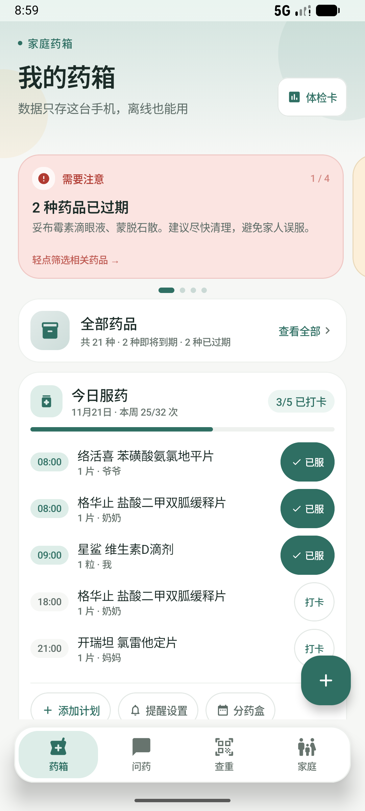
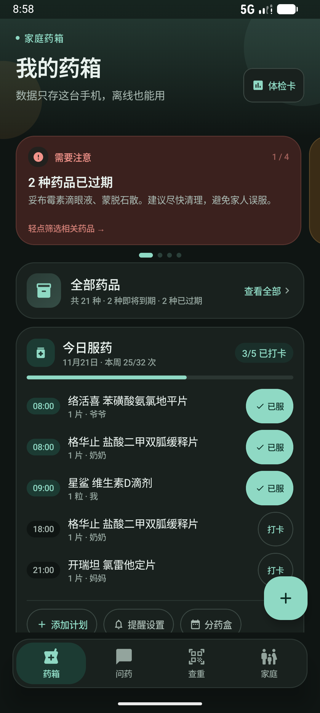
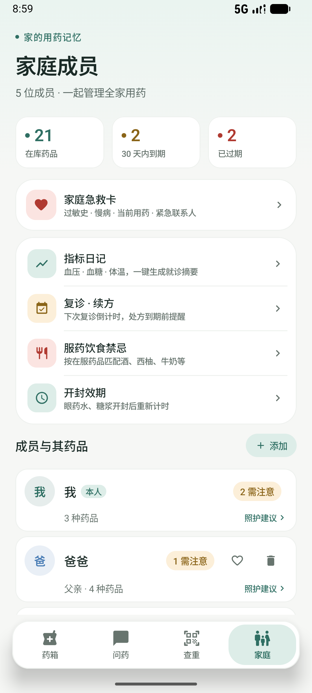

# 家庭药箱

一个面向家庭场景的用药管理 App：把「家里谁在吃什么药、什么时候吃、还剩多少、过期没有」集中管起来，并给老人提供看得清、按得动的操作界面。

使用 Kotlin + Jetpack Compose 编写，界面跟随系统深浅色，全部使用主题色。





## 功能

**药箱**

- 药品列表：按效期自动标记「正常 / 临期 / 过期」，支持搜索与成员筛选
- 添加药品：手动录入、拍照识别（ML Kit 中文 OCR）、语音输入
- 用药计划与提醒：按成员设置服药时间，AlarmManager 精确提醒，通知栏可直接打卡
- 服药打卡：今日进度、漏服记录，桌面小组件显示 `已完成/总数` 与下一次服药
- 分装与购物：一周药盒分装指引、缺药时生成购物清单
- 开封效期：滴眼液 28 天、糖浆混悬液 30 天、胰岛素 28 天等按开封日自动倒计时
- 月度报告：用药依从率、过期浪费统计

**问药**

- 本地药品知识库（`assets/drug_kb.json`），离线可用
- 对话式查询：可查库存、查相互作用、给用药与购物建议（AgentBrain 工具调用）

**查重**

- 扫描包装条码 / 手动选择，按成分比对，避免重复用药

**家庭**

- 成员与其药品：按人汇总药品、今日打卡、需要处理的过期与临期
- 成员照护建议：基于该成员的药、计划、打卡、复诊与开封记录，实时生成「该做什么 / 不该做什么 / 需要注意什么」
- 急救卡：血型、过敏史、慢病、紧急联系人，可一键拨打
- 指标日记：血压、血糖、体温、症状记录与折线趋势，可生成就诊摘要并复制/分享
- 复诊 · 续方日程：下次复诊倒计时、处方剩余天数、提前准备提示
- 服药饮食禁忌速查：13 类药 × 食物规则（西柚、酒、牛奶、浓茶等）
- 开封效期管家：集中查看已开封药品的剩余可用天数

**长辈模式**

- 一键放大字号（不改布局尺寸）、高对比配色，图标与卡片结构保持不变

## 技术栈

| 层 | 选型 |
| --- | --- |
| UI | Jetpack Compose + Material 3，动态取色跟随系统深浅色 |
| 语言 | Kotlin，minSdk 26 / targetSdk 37 |
| 识别 | ML Kit 中文文字识别（OCR） |
| 存储 | SharedPreferences + JSON、SQLite（`MediBoxDbHelper`）、StateFlow |
| 提醒 | AlarmManager 精确闹钟 + 通知栏动作 + AppWidget 桌面小组件 |
| 服务端 | FastAPI + SQLAlchemy + APScheduler + PyJWT（家庭组与计划同步） |

## 目录结构

```
app/src/main/java/com/family/medbox/
├── data/       # 存储（prefs / db / repo）、同步客户端、备份
├── domain/     # 药品知识库、相互作用、饮食禁忌、照护建议、月报等纯逻辑
├── notify/     # 提醒、闹钟 Receiver、通知
├── ui/         # Compose 页面（home / family / plan / follow / guide / check / report …）
├── util/       # 日期等工具
└── widget/     # 桌面小组件
server/app/     # 同步服务：账号、家庭组、计划同步、定时推送
```

## 构建

Android 工程需要 JDK 17 与 Android SDK 37：

```bash
./gradlew :app:assembleDebug
# 产物：app/build/outputs/apk/debug/app-debug.apk
```

安装到已连接设备：

```bash
adb install -r app/build/outputs/apk/debug/app-debug.apk
```

## 运行同步服务（可选）

```bash
cd server
python -m venv .venv
.venv/Scripts/pip install -r requirements.txt
.venv/Scripts/python -m uvicorn app.main:app --reload
```

服务默认监听 `127.0.0.1:8000`，App 内「家庭同步」可修改服务器地址；生产环境请通过环境变量 `MEDIBOX_SECRET` 覆盖默认开发密钥。

## 说明

- 本项目中的药品知识、相互作用与饮食禁忌为演示数据，**不构成医疗建议**，用药请遵医嘱。
- 仓库不包含签名文件与构建产物；Release 中的 APK 使用 debug 证书签名，可安装体验，但无法覆盖正式签名的版本。

## 许可

MIT License
